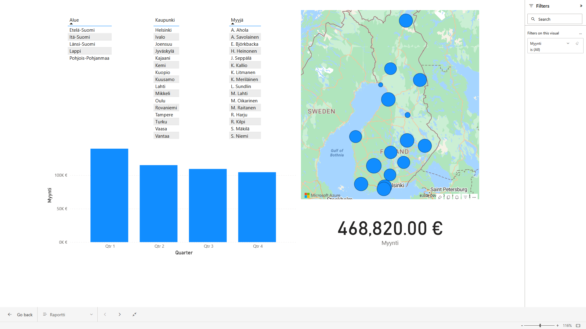
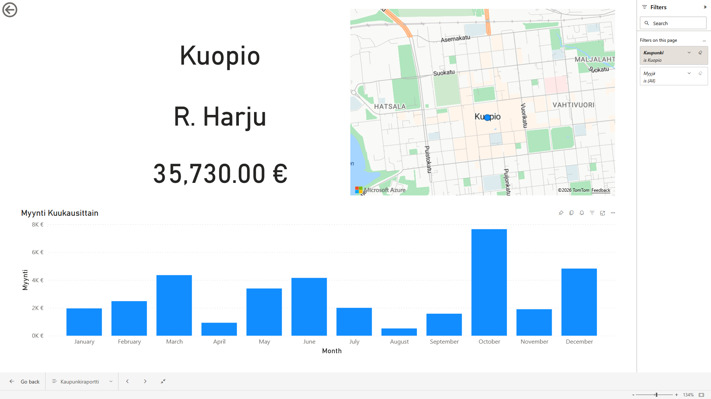
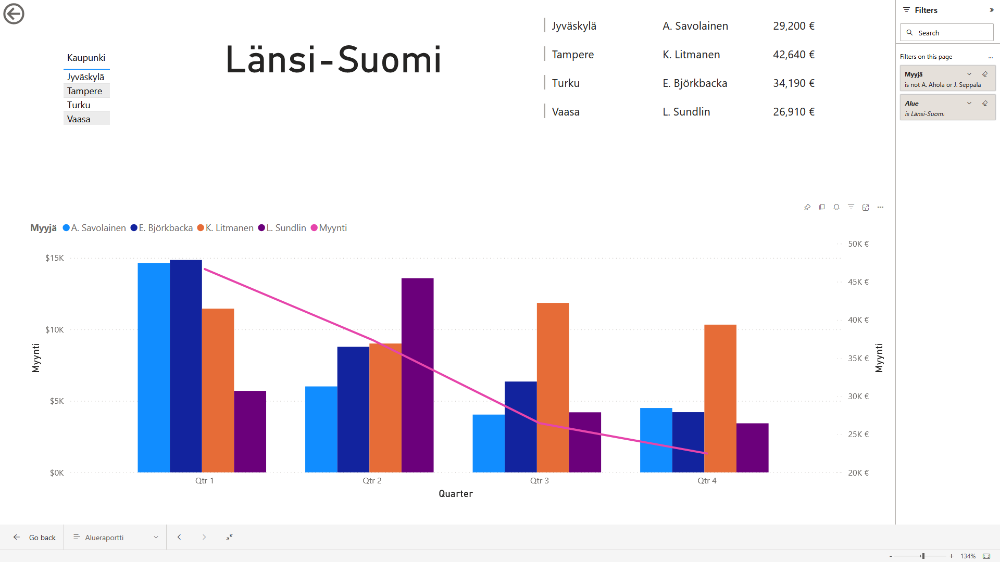

# Finnish Sales Performance Dashboard

An interactive Power BI portfolio project for exploring sales performance by seller, city, region, and time.

The report is built from a Finnish sales dataset and demonstrates how a small operational dataset can be transformed into a clear, filterable business dashboard.

## Portfolio summary

This project answers questions such as:

- What is the total sales value and how does it change over time?
- Which sellers and cities generate the most revenue?
- How is performance distributed across Finnish regions?
- Can users move from a national overview to city- and region-level detail?

### Key figures in the source data

| Metric | Value |
|---|---:|
| Sales records | 310 |
| Sellers | 16 |
| Total sales | 468,820 |
| Average sale record | 1,512.32 |
| Date range | 2018-01-02 to 2019-02-25 |
| Regions | 5 |

## Report pages

The PBIX contains three report pages:

### 1. Raportti — overall performance

The executive overview combines:

- Total sales KPI
- Sales trend by quarter
- Map of sales by Finnish city
- Breakdowns by region, city, and seller

### 2. Kaupunkiraportti — city analysis

The city-focused page supports location-level analysis with:

- Monthly sales trend
- City map
- City and seller context cards
- City-level performance comparison

### 3. Alueraportti — regional analysis

The regional page provides:

- Regional sales KPI
- Sales by city and seller
- Quarterly sales trend
- Combined regional and seller analysis

The report uses drill/filter interactions so users can move from a broad view into more detailed geographic and seller analysis.

## Dashboard preview

The included screenshots show the three report pages and the intended user experience:

### Overall report



### City report



### Regional report



## Data model

The source workbook, [`Myyntidata_powerBI_2.xlsx`](./Myyntidata_powerBI_2.xlsx), contains two related tables:

### `Myynti` — sales transactions

| Column | Description |
|---|---|
| `Myyjä` | Seller |
| `Myynti` | Sales amount |
| `Pvm` | Transaction date |

### `Myyjät` — seller geography

| Column | Description |
|---|---|
| `Myyjä` | Seller |
| `Kaupunki` | City |
| `Alue` | Region |

The geographic lookup enables the report to aggregate transaction-level sales by city and region while keeping seller analysis available throughout the report.

## Data preparation and modeling workflow

The report was built through a complete Power BI data preparation and modeling workflow:

1. **Import** — loaded the Excel sales and seller-geography tables into Power BI.
2. **Power Query cleaning** — reviewed the imported columns, applied the correct data types, removed duplicate rows, and kept the sales and seller reference data consistent.
3. **Data enrichment** — added calculated date attributes needed for analysis, including year, month, and quarter fields.
4. **DAX calculations** — created reusable calculations for sales totals, averages, record counts, and context-aware visual aggregations.
5. **Date hierarchy** — organized the date field into a time hierarchy so users can analyze performance by year, quarter, month, and day where appropriate.
6. **Model relationships** — connected the transaction table to the seller/geography table so sales can be filtered by seller, city, and region.
7. **Report design** — built KPI cards, maps, trend charts, tables, page navigation, and cross-filter interactions.

Representative DAX patterns used in the model include:

```DAX
Total Sales = SUM(Myynti[Myynti])

Average Sale = AVERAGE(Myynti[Myynti])

Sales Records = COUNTROWS(Myynti)
```

The calculations are designed to respond to the current filter context, so selecting a seller, city, or region updates the KPIs and visuals throughout the report.

## Selected findings

The dataset shows:

- **Länsi-Suomi** is the highest-performing region with **132,940** in sales.
- **Tampere** is the highest-performing city with **42,640** in sales.
- **K. Litmanen** is the highest-performing seller with **42,640** in sales.
- The report covers approximately 14 months, making both monthly and quarterly trends useful for comparison.

These figures are calculated from the included workbook and are intended to demonstrate the dashboard's analytical scope, not to represent current business performance.

## Tools and skills demonstrated

- Microsoft Power BI report design
- Data import from Excel
- Relational data modeling with a sales table and lookup table
- Geographic analysis with map visuals
- KPI cards and time-series analysis
- Aggregation by seller, city, region, month, and quarter
- Interactive filtering and report navigation
- Accessible, portfolio-oriented dashboard layout

## Files

```text
.
├── Myyntidata_powerBI_2.xlsx   # Source data
├── PowerBI_MiniTask.pbix       # Power BI report
├── Raportti.png                # Overall report screenshot
├── Kaupunki_raportti.png       # City report screenshot
├── Alue_raportti.png           # Regional report screenshot
└── README.md                   # Project documentation
```

## How to view the report

1. Install [Power BI Desktop](https://powerbi.microsoft.com/desktop/).
2. Open [`PowerBI_MiniTask.pbix`](./PowerBI_MiniTask.pbix).
3. Use the three page tabs to explore the overall, city, and regional views.
4. Select a city, region, or seller in a visual to cross-filter the rest of the page.

## Notes

- The report labels are in Finnish because the source data uses Finnish business terminology.
- Sales values are presented in the source dataset's numeric units; no currency symbol was supplied.
- The PBIX contains the report definition and imported model. The Excel workbook is included to make the source data and modeling approach transparent.

## Author

Created as a Power BI mini-project and portfolio demonstration focused on practical sales analytics, geographic reporting, and interactive dashboard design.
